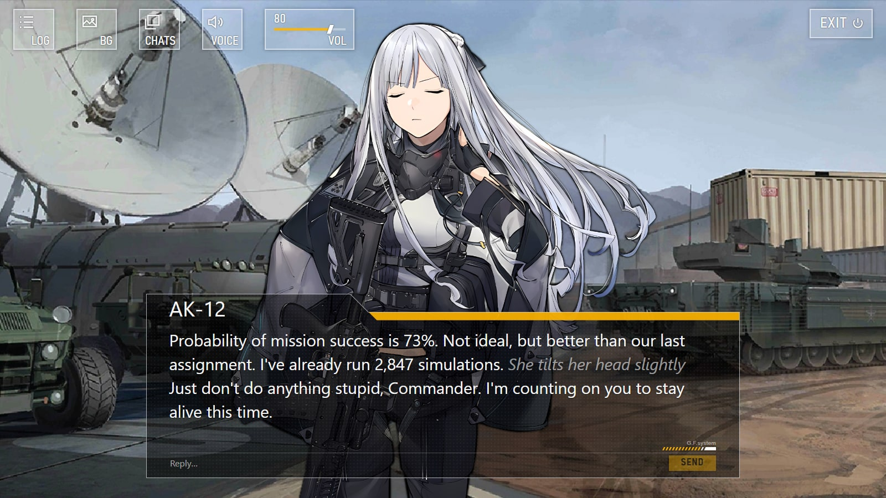
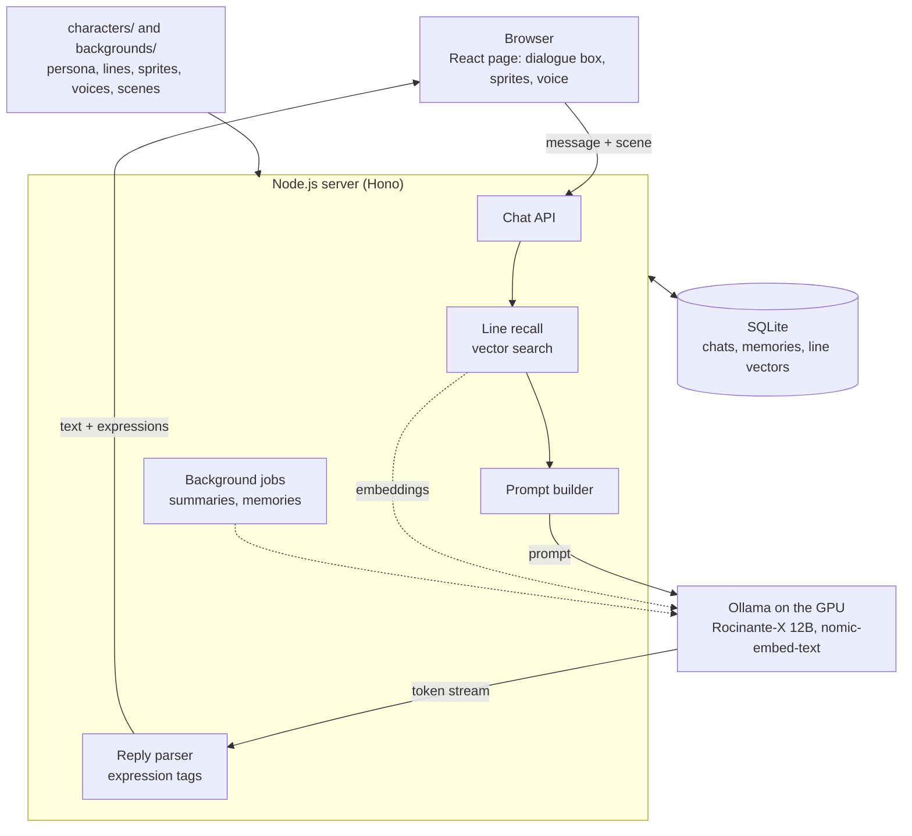

# chatAK12

A visual-novel style AI companion for talking with AK-12 from *Girls' Frontline*. It runs on your own computer through a local language model. The interface recreates the game's story screen, her face changes with her mood, she speaks with her in-game voice lines, and she remembers you across conversations.



The model runs on your graphics card with [Ollama](https://ollama.com), and conversations stay in a local database. You don't need a cloud service, an account or an API key.

## Features

- The dialogue box, name tab, icon buttons and "G.F.system" mark were measured from the game's UI and rebuilt in CSS, so they stay sharp at any window size and on phones.
- Replies stream in as they're generated, usually starting within about 0.3 seconds. They're in her voice and run one to three sentences.
- The model tags each reply with a facial expression and the sprite switches to match, even mid-reply. Invented tags such as `[smug]` map to the closest real sprite.
- A fitting voice clip from the game plays when her expression changes, with mute and volume controls.
- You can choose from 20 backgrounds. She knows where you are and notices when you move.
- Each message is matched by meaning against 1,969 of her lines from the game (retrieval-augmented generation). The closest lines go along with it, so she talks about people and events the way she did in the story.
- Lasting facts you mention, such as your name, job or pets, are saved and come back in later conversations. Long chats are summarized to fit the model's context window.
- You can browse, reopen and delete past conversations, read the full log, and see or delete what she remembers.
- `start.cmd` installs what's missing, starts Ollama, offers to download the models and opens the app. The EXIT button unloads the models and shuts everything down.

## Tech stack

| Area | Technology |
| --- | --- |
| Frontend | React 19, TypeScript, Vite, hand-written CSS (container query units for size-independent layout) |
| Backend | Node.js 24 (runs TypeScript natively, built-in SQLite), Hono web framework |
| AI | Ollama, [Rocinante-X 12B](https://huggingface.co/TheDrummer/Rocinante-X-12B-v1-GGUF) (a Mistral Nemo roleplay finetune), Q5_K_M quantization; [nomic-embed-text](https://ollama.com/library/nomic-embed-text) for retrieval |
| Images | sharp, for on-demand background thumbnails |
| Data | SQLite: conversations, messages, summaries, memories and cached embeddings |

The project is about 3,400 lines of TypeScript and CSS, type-checked in strict mode, with three packages on the server.

## Architecture



How a reply gets to the screen:

1. The page sends your message and the current background.
2. The server saves the message and finds her lines closest to it in meaning. It builds the prompt from the character sheet, what she remembers about you, a summary of older messages, the scene, the recent conversation and the recalled lines.
3. Ollama streams the reply back. A streaming parser pulls out the expression tags and sends text and expression changes to the page as newline-delimited JSON.
4. The page types the text into the dialogue box, swaps the sprite and plays a voice clip.
5. Background jobs then update the conversation summary and pick out new memories, one at a time.

## Engineering notes

### Prompt layout and caching

The character sheet goes at the start of the conversation, where it stays identical from turn to turn. A short set of rules goes with the latest message, where the model pays most attention. Ollama reuses its cached work for the unchanged start, so it processes a prompt of 2,000 to 2,700 tokens in 0.1 to 0.3 seconds.

### Prompt changes for Rocinante-X

Rocinante-X was trained without system prompts. With the character sheet sent as one, it narrated her actions in the second person, wrote 84-word replies and invented its own expression tags. I moved the sheet into the conversation and restated the main rules at the end, which brought replies down to 33 words with valid tags and third-person actions:

| | Before | After |
| --- | --- | --- |
| Average reply | 84 words | 33 words |
| Time per reply | 3 to 4 s | 1 to 2 s |
| Expression tags | 1 leaked into the text, 2 invented | All valid |

### Streaming tag parser

Tokens arrive in arbitrary pieces (`[`, `ser`, `ious]`), so a small state machine recognizes the tags and holds back text only while a tag might still be forming. It also skips stray reasoning blocks and leaves other bracketed text visible. An unknown opening tag maps to the closest expression, found by comparing it with each sprite's description.

### Line recall

Her 1,969 usable lines are embedded once with nomic-embed-text. The vectors are cached in SQLite, so later starts load them in a moment. Each message is embedded and compared with every line by cosine similarity in plain TypeScript, with no vector database, and the whole search takes about 15 ms.

The top five lines above a threshold go with the latest message. They stay out of the character sheet so the prompt cache keeps working. I set the threshold from measured scores: lines about what was asked score 0.65 to 0.85 ("Tell me about AN-94", "Why do you keep your eyes closed?"), while small talk like "hi" only finds loose matches around 0.55 to 0.63 and gets no lines. The embedding model takes 340 MB of video memory and stays loaded beside the chat model.

### Memory

Memory extraction asks the model for JSON that must match a schema, which Ollama enforces. It only runs when you've said something about yourself, so messages like "Enemy contact!" cost no model time.

### Startup warm-up

The server loads the model and processes the character sheet as soon as it starts. That cut the time to the first words of the first reply from 3 to 6 seconds down to 0.19 seconds.

### Measured performance

On an RTX 4070 SUPER (12 GB):

| | Result |
| --- | --- |
| First words of a reply | About 0.2 to 0.4 s |
| Full reply (one to three sentences) | About 2 s |
| Generation speed | About 37 tokens/s |
| All 20 background thumbnails | 163 KB, compared with 10.5 MB of full images |

### Reliability and security

- A second send to a conversation that's still replying gets a 409. The page removes any message the server didn't save and puts the text back in the input.
- The page recovers on its own if the server starts late or a conversation is deleted while it's open.
- Static files are revalidated with `If-Modified-Since` (304 responses), and requests are guarded against path traversal.
- Shutdown requires a custom header, so other websites can't trigger it.
- The server only listens on this computer, only answers to `localhost` (which stops DNS rebinding) and only takes messages as JSON, so other devices and websites can't reach your chats.
- Flash attention and an 8-bit context cache save about 600 MB of video memory, which keeps the model from spilling out of a 12 GB card. The launcher sets them when it starts Ollama. If Ollama is already running, set `OLLAMA_FLASH_ATTENTION=1` and `OLLAMA_KV_CACHE_TYPE=q8_0` as environment variables.

## Getting started

### Requirements

| | |
| --- | --- |
| System | Windows 10 or 11. Mac and Linux can run `npm run launch` (untested). |
| Software | [Node.js](https://nodejs.org) 24 or newer and [Ollama](https://ollama.com) |
| Graphics card | About 12 GB of video memory (tested with an RTX 4070 SUPER). Smaller cards work, but slower, since part of the model runs on the CPU. |
| Disk space | About 10 GB, mostly for the models |
| Internet | Only for the first run, to download packages and models |

### Starting it

Install Node.js and Ollama, then double-click `start.cmd`. It:

1. installs packages if they're missing or out of date,
2. starts Ollama if it isn't running,
3. offers to download the models if they aren't there yet: Rocinante-X 12B (Q5_K_M, 8.7 GB) and nomic-embed-text (about 270 MB, optional),
4. builds the page if anything changed since the last build,
5. starts the app and opens http://localhost:3001 in your browser.

Keep the command prompt window open while you chat. To stop, use the EXIT button at the top right of the page. It unloads the models, closes Ollama if the launcher started it, and stops the app. Closing the window or pressing Ctrl+C also stops it.

Double-clicking `start.cmd` while the app is running just opens the page. `npm run launch` does the same as `start.cmd` from a terminal, and `--no-open` skips opening the browser.

## Development

```
npm install
npm run dev
```

This runs the server and the page with live reloading at http://localhost:5173. Ollama has to be running already.

| Command | What it does |
| --- | --- |
| `npm run dev` | Server and page with live reloading |
| `npm run typecheck` | Strict type checking of the server and the page |
| `npm test` | Tests for the reply parser, stream reader and host check |
| `npm run build` | Builds the page into `dist/` |
| `npm start` | Runs the server, which also serves the built page, on http://localhost:3001 |
| `npm run launch` | The launcher behind `start.cmd` |
| `npm run package` | Builds the ready-to-run copy (see below) |

## Configuration

Copy `.env.example` to `.env` and change what you need. Every setting is optional.

| Setting | Default | Meaning |
| --- | --- | --- |
| `OLLAMA_MODEL` | Rocinante-X 12B Q5_K_M | Any model Ollama can run |
| `FOLD_SYSTEM_PROMPT` | `1` | `1` puts the character sheet in the conversation (for models trained without system prompts); `0` sends it as a system prompt |
| `TEMPERATURE` | `1` | Higher is more varied, lower more predictable |
| `NUM_CTX` | `8192` | Context window, in tokens |
| `REPLY_TOKENS` | `1024` | Longest reply, in tokens |
| `HISTORY_TOKEN_LIMIT` | `3000` | When older messages start being summarized |
| `KEEP_RECENT_MESSAGES` | `10` | Messages always kept word for word |
| `EMBED_MODEL` | `nomic-embed-text` | Embedding model for recalling her lines; empty turns recall off |
| `OLLAMA_KEEP_ALIVE` | `30m` | How long the model stays loaded between messages |
| `SERVER_PORT` | `3001` | Port the app runs on |
| `CHARACTER` | `ak12` | Folder under `characters/` |

## Project structure

| Path | What it is |
| --- | --- |
| `characters/ak12/persona.md` | Her personality and character sheet, written from her in-game dialogue. The `# Heading` is her display name. Edits apply on the next message. |
| `characters/ak12/sprites/` | One image per expression. The file name is the expression name, and the model picks from whatever is here. `default.png` is used when it doesn't pick one. |
| `characters/ak12/lines.json` | Her lines from the game, recalled by meaning for each message. I got them with [GFL-Character-Dialogue-Extract](https://github.com/OreoJuice/GFL-Character-Dialogue-Extract). |
| `characters/ak12/expressions.json` | What each sprite looks like, so the model picks fitting expressions. |
| `characters/ak12/voices/` + `voices.json` | Her voice clips (Japanese, from the game), grouped by expression. |
| `backgrounds/` + `scenes.json` | Background images and what each one shows. Add or remove files and reload the page. |
| `server/` | The Node server: chat API, prompt building, reply parsing, memory, thumbnails and shutdown. |
| `web/` | The React frontend. |
| `shared/` | Types and helpers used by both. |
| `scripts/` | The one-click launcher and the packaging script. |
| `data/` | Created on first use: the SQLite database and cached thumbnails. Never committed or shared. |

## Sharing it

Run this in the development copy:

```
npm run package
```

It makes a ready-to-run copy in `release/chatAK12` and `release/chatAK12.zip`, with the full source, the page prebuilt, a short user guide and this documentation. Whoever gets it unpacks the zip and double-clicks `start.cmd`. Conversations, memories and `.env` are never included.

## Credits

- *Girls' Frontline* characters, artwork and voice lines belong to MICA Team and Sunborn Network. This is a non-commercial fan project, not affiliated with or endorsed by them. Sprites, backgrounds and voice clips came from the game and the [IOP Wiki](https://iopwiki.com).
- AK-12's lines were extracted with [GFL-Character-Dialogue-Extract](https://github.com/OreoJuice/GFL-Character-Dialogue-Extract), which pulls its data from [gf-data-us](https://github.com/gf-data-tools/gf-data-us).
- [Rocinante-X 12B](https://huggingface.co/TheDrummer/Rocinante-X-12B-v1-GGUF) by TheDrummer.

## License

The source code is under the [MIT License](LICENSE). The *Girls' Frontline* assets are not covered by it; see the license file.
